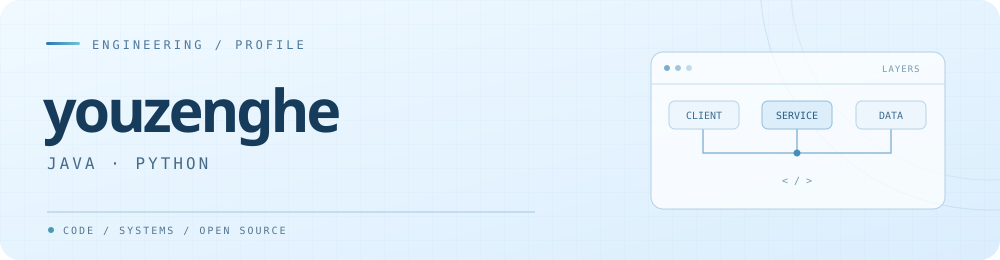
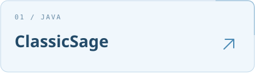
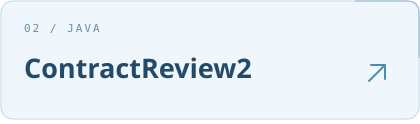
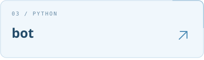
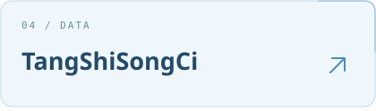

  

<h3 align="center">尤赠贺  / youzenghe</h3>

主要写 Java，也用 Python。

河南财经政法大学 · 2025—2026 届开源软件社团社长

<a href="mailto:skyberggrenzmb3391@gmail.com">Gmail · 联系</a>

### Languages & tools

  &nbsp;&nbsp;
  &nbsp;&nbsp;
  &nbsp;&nbsp;
  &nbsp;&nbsp;
  &nbsp;&nbsp;
  &nbsp;&nbsp;
  &nbsp;&nbsp;
  &nbsp;&nbsp;
  &nbsp;&nbsp;
  &nbsp;&nbsp;
  

### Repositories

  
  
  
  

### Contributions

<picture>
  <source media="(prefers-color-scheme: dark)" srcset="https://raw.githubusercontent.com/youzenghe/youzenghe/output/snake-dark.svg" />
  <source media="(prefers-color-scheme: light)" srcset="https://raw.githubusercontent.com/youzenghe/youzenghe/output/snake.svg" />
  
</picture>
